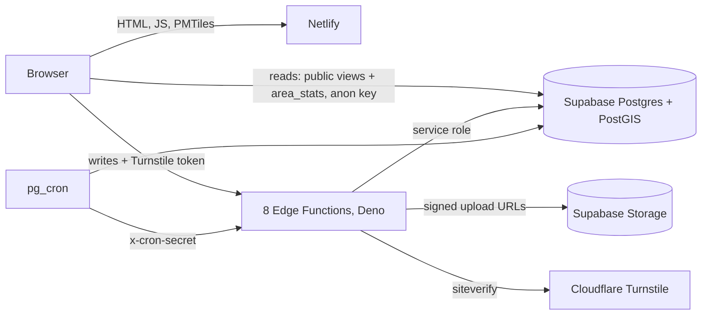

# guwahati-rent

An anonymous, crowdsourced rent map for Guwahati. Renters pin what they pay (no name, no contact, location rounded to ~110 m), and anyone can see medians by locality, monsoon waterlogging reports and photos of To-Let boards.

**Live:** https://guwahati-rent.netlify.app · **Release:** `v0.5.0` · **Status:** wrapped (maintenance mode), see below.

## Status (26 Nov 2026)

The project is **wrapped**: no further feature phases. Phase 3 (owner listings, seeker matching, email digests) and Phase 4 (locality SEO pages, Rent Index) are **cancelled**. Only bug fixes, security fixes and the wrap-up items are in scope.

| | |
|---|---|
| Frontend | `main` auto-deploys to Netlify (Phases 0, 1, 2a, 2, 2b importer, 2c) |
| Database | Supabase `ngssgjuagrlyhsvtiwhk`, South Asia (Mumbai); migrations `0001`–`0010` applied. `0011_pin_erasure.sql` (real pin deletion) is in the repo and not yet applied: see [DEPLOY.md](DEPLOY.md) |
| Edge Functions | all 8 deployed (2c.2 versions) |
| Public data | **0 rents, 0 To-Let boards** on the live map (checked 26 Nov). The map works but is empty until real rents are added |
| Demo showcase | built, opt-in (`VITE_DEMO_SHOWCASE`), **off** in production |
| Open items | [docs/wrap/WRAP_REPORT.md](docs/wrap/WRAP_REPORT.md) (release verdict) and [docs/wrap/HUMAN_REQUIRED.md](docs/wrap/HUMAN_REQUIRED.md) (owner actions) |

[STATUS.md](STATUS.md) is the owner's status log. The `docs/wrap/` reports are the latest audit. Where they disagree on a finding, the newer dated document wins.

## Quick start

```bash
git clone https://github.com/myogesh97/guwahati-rent.git && cd guwahati-rent
npm ci                     # Node 22+
cp .env.example .env       # optional: fill VITE_SUPABASE_URL + VITE_SUPABASE_ANON_KEY
npm run dev                # http://localhost:5173
```

With no `.env` the map runs **read-only** (no pins, "Pin your rent" disabled). Use only the anon / publishable key in `.env`, **never** the service-role or secret key. In dev without a Turnstile key, Cloudflare's always-pass test key is used.

## Architecture



- **Frontend** (`src/`): Vite 6 + TypeScript, no framework. MapLibre GL 6 renders one GeoJSON source (never a DOM marker per pin) over self-hosted Protomaps tiles (`public/tiles/guwahati.pmtiles`). The map chunk is lazy-loaded after first paint.
- **Reads**: plain `fetch` to PostgREST views (`public_pins`, `public_tolet`, `public_stats_city`, `public_stats_locality`) and the `area_stats` RPC. Private tables are not readable by the anon key.
- **Writes**: only through Edge Functions (`supabase/functions/`): `submit-pin`, `edit-pin`, `report-pin`, `tolet-upload-url`, `submit-tolet`, `report-tolet`, `admin-review`, `tolet-maintenance`. Each validates with zod, verifies Turnstile server-side, rate-limits on salted IP and browser hashes, and rounds coordinates (pins 3 dp, boards 4 dp).
- **Privacy in the database** (`0010_privacy_k_anon.sql`): a society name is public only when 3+ pins within 300 m share it; size is public only as a band; stats are medians of groups of 3+.
- **Admin**: `/admin.html`, Supabase Auth magic link, gated by the `admins` table inside `admin-review`.

Rules that must never be broken are in [SPEC.md](SPEC.md) §5 (also summarised in [CLAUDE.md](CLAUDE.md)).

## Scripts

| Command | What it does |
|---|---|
| `npm run dev` / `build` / `preview` | Vite dev server, production build to `dist/`, serve the build |
| `npm run typecheck` / `lint` | `tsc --noEmit`, ESLint |
| `npm test` | Node unit tests (`tests/*.test.ts`) |
| `npm run test:deno` | Edge Function helper tests (Deno) |
| `npm run test:db` | Applies every migration to a throwaway local Postgres + PostGIS and asserts the security and stats rules. Never touches production |
| `npm run test:browser` | Headless Chrome over 6 viewports with the production CSP. Writes to Supabase are blocked; reads hit the project in `.env`. Three checks need at least one live pin |
| `npm run security-check` | Anon-key probes against a live project. Seed the test rows from the script header first, then delete them |
| `npm run import-survey -- file.csv --dry-run` | Survey CSV importer (Phase 2b). Without `--dry-run` it needs `SUPABASE_SERVICE_ROLE_KEY` in the environment |

Before any commit: `npm run typecheck && npm run lint && npm test && npm run test:deno && npm run test:db && npm run build`. CI runs the same, plus `npm audit --omit=dev`.

## Environment variables

Frontend (`.env`, baked in at build time, public by design):

| Variable | Notes |
|---|---|
| `VITE_SUPABASE_URL` | `https://<ref>.supabase.co` |
| `VITE_SUPABASE_ANON_KEY` | anon / publishable key only |
| `VITE_TURNSTILE_SITE_KEY` | add the site hostname to the widget's allowed domains |
| `VITE_SITE_URL` | canonical origin; a `localhost` value is ignored in production builds |
| `VITE_TILES_URL` | optional external PMTiles URL (also add it to the CSP `connect-src`) |
| `VITE_DEMO_SHOWCASE` | optional, keep unset in production |

Edge Function secrets (`npx supabase secrets set …`, never in a `VITE_` variable): `TURNSTILE_SECRET_KEY`, `HASH_SALT`, `ALLOWED_ORIGINS`, `CRON_SECRET` (same value as the Vault secret `cron_secret`), optional `CLIENT_IP_HEADER`. `SUPABASE_URL` and `SUPABASE_SERVICE_ROLE_KEY` are injected by the runtime.

GitHub Actions secrets: `SUPABASE_URL`, `SUPABASE_ANON_KEY` (keepalive), `SUPABASE_DB_URL` (Session pooler string, backups), `BACKUP_AGE_RECIPIENT` (age public key, backups), `NETLIFY_BUILD_HOOK_URL`.

## Deploying

Order is always **database → functions → frontend**. Full steps and rollback: [DEPLOY.md](DEPLOY.md).

```bash
npx supabase link --project-ref <ref>
npx supabase db push                                    # migrations
npx supabase functions deploy <name> --no-verify-jwt    # each changed function
git push origin main                                    # Netlify builds and publishes
```

Setting up a new Supabase project from scratch (extensions, secrets, Vault, cron, admin user, Auth redirect URLs) is the walkthrough in [MIGRATE-REGION.md](MIGRATE-REGION.md).

## Operations

| Workflow | Schedule | Purpose |
|---|---|---|
| `ci.yml` | push to `main`, PRs | audit, typecheck, lint, tests, build, bundle assertions; database job on Postgres 17 + PostGIS |
| `backup.yml` | Sunday 03:30 IST | `pg_dump` of the `public` schema, encrypted with [age](https://age-encryption.org) to `BACKUP_AGE_RECIPIENT`, kept as a 90-day artifact. The private key stays offline with the owner. Artifacts of a public repo can be downloaded by any signed-in GitHub user, so the job refuses to run without the key |
| `keepalive.yml` | every 2 days | one anon read so the free Supabase project doesn't pause |
| `nightly-rebuild.yml` | 03:30 IST | Netlify build hook (keeps `sitemap.xml` fresh) |

Dependabot opens weekly PRs for npm and Actions. Security reports: [SECURITY.md](SECURITY.md).

## Demo mode (development only)

`npm run dev`, then open `/?demo=normal|dense|stress|crowded|packed|max|full|showcase` (25 to 20,000 fictional pins). Demo pins are generated in the browser, never stored, and labelled DEMO everywhere; adding pins is off. The code is behind `import.meta.env.DEV`, and CI checks that `dist/` contains none of it. A build with `VITE_DEMO_SHOWCASE=true` adds the 45 showcase pins next to real ones; keep that to Deploy previews.

## Repository map

| Path | Contents |
|---|---|
| `src/` | app (`main.ts`, `map.ts`, `layers.ts`, `filters.ts`), forms, UI, admin page, styles, dev-only `demo/` |
| `supabase/migrations/` | `0001`–`0011`, applied in order |
| `supabase/functions/` | 8 Edge Functions + `_shared/` (rules, PII filter, Turnstile, rate limits) |
| `tests/` | Node unit tests; `tests/db/` the database suite |
| `scripts/` | security gate, browser smoke test, survey importer, diagnostics |
| `public/` | tiles, map fonts and sprite, `localities.json` (must equal `_shared/localities.ts`; a test enforces it) |
| `docs/wrap/` | final audit: report, ledger, ACR, threat model, release checklist, owner actions, ADRs |

Design and history: [SPEC.md](SPEC.md) (v2, original design), [NEXT-PHASES.md](NEXT-PHASES.md), [PHASE-2C.md](PHASE-2C.md), [CHANGELOG.md](CHANGELOG.md). Root-level `*_REPORT.md`, `*_CHECKLIST.md` and `*_ANALYSIS.md` files are dated snapshots from 12–26 Nov, kept for history.

## Deviations from SPEC v2

- Living-condition fields (water, monsoon detail, power) go beyond SPEC §6.1 at the owner's request: optional, no contact data, shown as "reported by the renter, not verified".
- flatpickr (MIT) added for one date field, loaded on demand.
- "Spot a To-Let" is its own button rather than a choice inside the add dialog.
- Map centre is `[91.77, 26.15]`, so phones open on the central belt.
- Tiles, glyphs and sprite are self-hosted from the site instead of R2.
- Reads use plain `fetch` instead of supabase-js (smaller bundle); zod runs only in the Edge Functions.
- Public functions use `verify_jwt = false` and protect themselves (Turnstile, rate limits, tokens). This is required for `sb_publishable_` keys.

## Licence

No licence file yet: all rights reserved by default. See [docs/wrap/HUMAN_REQUIRED.md](docs/wrap/HUMAN_REQUIRED.md).
